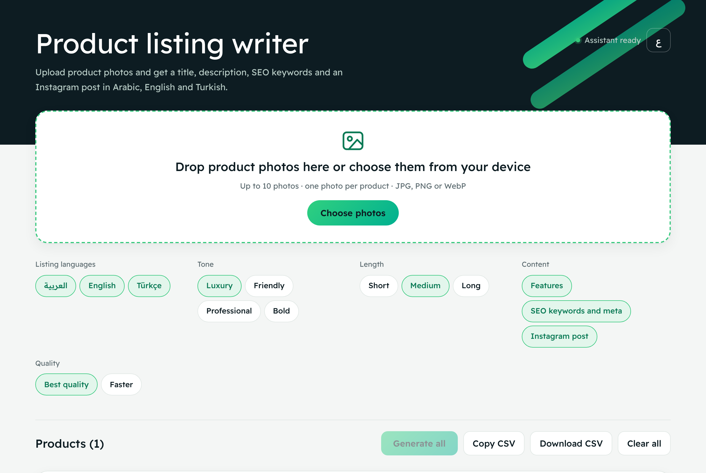
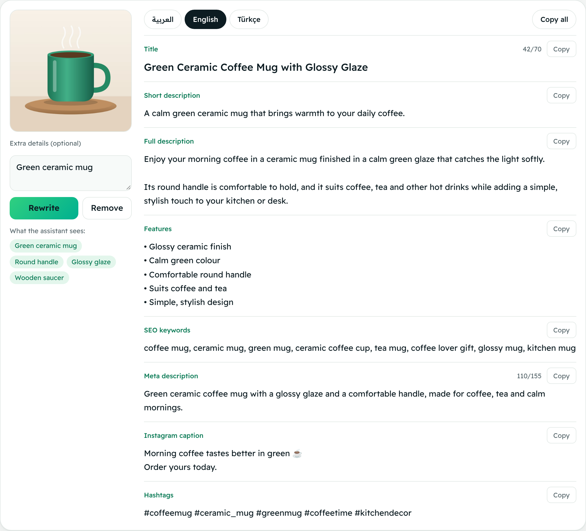
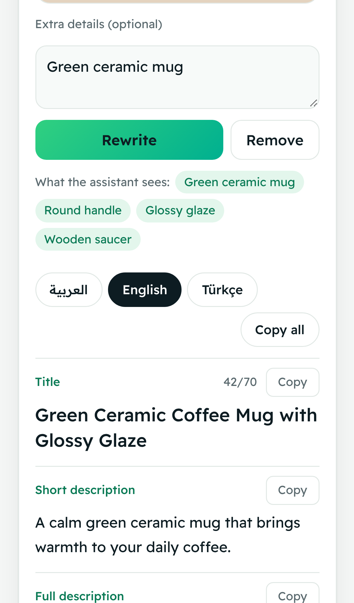

# Product listing writer

**Live demo: [listing.awsankhaled.com](https://listing.awsankhaled.com)**

Upload up to 10 product photos and get ready-to-paste store listings in Arabic, English and Turkish:
a title, a short and a full description, feature points, SEO keywords, a meta description, an Instagram
caption and hashtags. Pick the tone, length and sections, edit any field in place, copy it with one click,
or export everything as CSV for Excel or Google Sheets. The interface works in Arabic (right to left)
and English, on desktop and on phones.



<p>
  
  
</p>

<sub>The screenshots are taken by <code>tests/browser-test.js</code> against the mock API, so the listing text is sample text.</sub>

## How it works

1. The page shrinks each photo to at most 1568 px on the long side and converts it to JPEG in the browser.
2. For each product it sends one request per selected language to `api/generate.php`, in parallel, with at most
   3 requests at a time on the page. Each language tab fills in as its result arrives; a language that fails shows
   its error and a retry button on its own tab. **Generate all** still goes product by product.
3. `api/generate.php` checks the Origin header, the rate limits, every form value and the photo itself,
   then builds the prompt on the server. The browser never sends prompt text or a model name.
4. The server calls the Claude Messages API with the photo, the prompt and a JSON schema
   (structured outputs), so the reply is always valid JSON: `{seen: {product, items[]}, listing: {title, short, description, ...}}`.
   Only the sections you picked are in the schema.
5. The reply is trimmed, capped and cleaned (hashtags always start with `#`), then sent to the browser as
   `{seen, listing}`, or as `{error: code}` with a friendly Arabic or English message on the page.

`api/health.php` tells the page whether the demo is ready (the status dot in the header) without calling Claude.

## Project structure

```
index.html              The whole front end: inline CSS and JS, Arabic/English interface
favicon.svg, apple-touch-icon.png, og-image.png
api/
  generate.php          POST multipart/form-data -> {seen, listing} or {error}
  health.php            GET -> {ok: true} when the config is found and has a key
  lib/                  Server-only code, blocked from the web
    config.php          Finds and loads the private config, prepares the storage folder
    limits.php          Rate limits and the usage log (files + flock)
    listing.php         Form validation, the prompt, the JSON schema and the output sanitizer
    anthropic.php       The Claude API call over cURL, retries and error mapping
    http.php            JSON responses, Origin check, anonymous visitor key
config.example.php      Template for the private config file
.htaccess               LiteSpeed/Apache rules: blocks private files, sets security headers
tests/
  smoke.sh              API checks with php -S and a mock, then the browser test
  browser-test.js       Headless Chromium checks and the README screenshots
  mock-anthropic.php    A fake Claude API for tests (no key, no cost)
  check-deploy.sh       Checks a live site: blocked paths, health check, headers
docs/screenshots/       README images
```

Plain PHP 8.1+ with cURL: no SDK, no Composer and no build step.

## Deploying on Hostinger

Hostinger's Git deployment copies the files from `main` as they are into the site folder.
The API key lives in a private file one level above `public_html`, where the web server can't serve it.

1. **Create the subdomain.** In hPanel, open **Domains → Subdomains** and create `listing` for `awsankhaled.com`.
   Note its folder, usually `public_html/listing`. If hPanel put a default page in it, delete it in
   **File Manager**: Git deployment needs an empty folder.
2. **Pick PHP 8.1 or newer.** In **Advanced → PHP Configuration**, choose PHP 8.1+ (8.3 recommended).
   The `curl` extension is on by default.
3. **Connect the repository.** In **Advanced → Git**:
   - Repository: `https://github.com/Awsan01/product-listing-writer.git`. For a private repository, use the SSH
     address (`git@github.com:Awsan01/product-listing-writer.git`) and add the SSH key hPanel shows there as a
     read-only **Deploy key** in GitHub (repository **Settings → Deploy keys**).
   - Branch: `main`
   - Directory: `listing` (the subdomain folder, relative to `public_html`)

   Click **Create**, then **Deploy**. To redeploy on every push, turn on **Auto deployment**, copy the webhook URL
   and add it in GitHub under **Settings → Webhooks** (push events only).
4. **Create the private config.** In **File Manager**, go to `domains/awsankhaled.com/`, the folder that contains
   `public_html`. Create a folder named `private` and, inside it, a file named `listing-config.php`. Paste the
   contents of [`config.example.php`](config.example.php) and put your API key in `anthropic_api_key`
   (create one at [platform.claude.com/settings/keys](https://platform.claude.com/settings/keys)).
   Set the folder's permissions to `700` and the file's to `600`.

   ```
   domains/awsankhaled.com/
   ├── private/
   │   ├── listing-config.php      <- your key (create this)
   │   └── listing-storage/        <- created by the app: rate limits and usage logs
   └── public_html/
       └── listing/                <- deployed from GitHub
   ```

   The app looks for `private/listing-config.php` in each folder above itself (up to 6 levels), skipping
   `public_html` and everything inside it. If hPanel gave the subdomain its own folder
   (`domains/listing.awsankhaled.com/public_html`), put the file in `domains/listing.awsankhaled.com/private/`.
   You can also point the `LISTING_CONFIG` environment variable at any path.
5. **Turn on SSL** for the subdomain in **Security → SSL** and force HTTPS.
6. **Check it.** Open [listing.awsankhaled.com](https://listing.awsankhaled.com): the dot next to the language button
   should be green ("Assistant ready"). From your computer, run:

   ```bash
   tests/check-deploy.sh https://listing.awsankhaled.com
   ```

   It checks that `.git`, the config files, `api/lib/` and `tests/` are blocked, that the health check works and that the
   security headers are set. It never sends a photo, so it costs nothing.

### Pausing the demo

Set `'enabled' => false` in `private/listing-config.php` and save. Every API call then returns 503 and the page shows
"The demo is paused" with an orange status dot. Set it back to `true` to resume. Both take effect on the next request.
For an emergency stop, you can also disable the key in the Claude Console.

### Usage and limits

Each request (one language of one product) adds a line to `private/listing-storage/usage-YYYY-MM.csv`:
time, model, language, input and output tokens, and status. No photos, notes or IP addresses are written.
Status `ok_cut` means a reply hit `max_tokens` and only its finished fields were kept; if you see it often, raise
`max_tokens`. Lines for requests rejected before Claude was called stop once the month's file passes 5 MB, so junk
traffic can't fill the disk; Claude calls are always logged.

The default limits in the config are 30 requests per hour and 60 per day for each visitor IP, and 600 per day for the
whole site (midnight UTC). A product in three languages counts as three requests. **Stop** cancels the wait in the
browser, but a request that has already reached the server still finishes, and counts toward the limits and the bill.

## Local development

You need PHP 8.1+ with the curl extension.

```bash
cp config.example.php config.local.php
```

Put your key in `config.local.php` (it is gitignored, and only PHP's built-in server reads it), then start the server
from the repository root:

```bash
PHP_CLI_SERVER_WORKERS=4 php -S 127.0.0.1:8000
```

Open http://127.0.0.1:8000. `PHP_CLI_SERVER_WORKERS` lets the built-in server handle the parallel language requests.

To work without a key or any cost, run the mock API in a second terminal:

```bash
php -S 127.0.0.1:8792 tests/mock-anthropic.php
```

and set `'anthropic_api_key' => 'test'` and `'anthropic_base_url' => 'http://127.0.0.1:8792'` in `config.local.php`.
The mock returns a sample listing; notes such as `mock:overloaded`, `mock:credit` or `mock:slow` trigger error cases
(see the top of [`tests/mock-anthropic.php`](tests/mock-anthropic.php)).

### Tests

```bash
tests/smoke.sh
```

This starts the app and the mock with `php -S` and checks valid photos, rejected files (not an image, over 5 MB,
over 4000 px), unknown settings, wrong or missing Origin, retries, Claude errors, rate limits, the paused demo, missing
config and the usage log, and runs `php -l` on every PHP file. When Node.js with Playwright is installed it also runs
`tests/browser-test.js`, which uses the page in headless Chromium: uploads a photo, writes it in three languages,
checks the 1568 px resize, edits a field, downloads the CSV, switches the interface language, tests Stop (including
during Generate all and after a double-click), a failed language with retry and every error message, and checks the
phone layout. Use `--no-browser` to skip it, `--shots docs/screenshots` to refresh the README screenshots, and
`KEEP_WORK=1` to keep the test config, storage and server logs.

## Changing tones, fields and languages

The server whitelists and the prompt are in [`api/lib/listing.php`](api/lib/listing.php); the interface texts are in
the `T` object in [`index.html`](index.html). Change both sides together.

- **Tones and lengths:** add an entry to `TONES` or `LENGTHS` in `listing.php` (key and the words the prompt uses),
  and the same key with its label to `tones` or `lengths` in both `T.ar` and `T.en`.
- **Fields:** add a rule line in `build_prompt()`, the field to `listing_fields()` and a cap to `FIELD_CAPS`.
  In `index.html`, add it to `KEYS`, give it a label in `fields` (Arabic and English), and add it to `LIMIT` if it
  should show a character counter.
- **Listing languages:** add the language to `LANG_NAMES` in `listing.php` and, if it needs a style note, to the
  "Write each language natively" rule. In `index.html`, add its code to `LANGS` and its name to `lname`
  (Arabic and English); right-to-left languages also need the `dir` check in `fieldsHTML()`.
- **Interface languages:** add a block to `T` and the code to `UI_LANGS` in `listing.php`.

## Models and costs

The browser only says "best" or "fast"; the config maps them to models:

| Quality | Model (default) |
|---|---|
| best | `claude-sonnet-5-5` |
| fast | `claude-haiku-5-5` |

Each request sends one photo (at most 1568 px on the long side) and a short prompt and allows up to 1,500 output
tokens (`max_tokens`). Writing one product in three languages makes three requests, and the photo is sent with each.
The JSON comes back through structured outputs (`output_config.format`) rather than a forced tool call, because
`claude-sonnet-5-5` rejects a forced `tool_choice`.

Thinking tokens count toward `max_tokens`, and a long Arabic listing with every section is close to 1,500 tokens on
its own, so the two default models run with thinking off (`between_tools` for `claude-sonnet-5-5`, `disabled` for
`claude-haiku-5-5`, at low effort). Other models you put in the config keep adaptive thinking at low effort; the
settings are in `THINKING_OFF` in [`api/lib/anthropic.php`](api/lib/anthropic.php). If a reply is still cut off, the
fields that were finished are returned and the half-written one is dropped.

Cost per request = input tokens (photo and prompt) × the model's input price + output tokens × its output price.
Prices are on [Anthropic's pricing page](https://platform.claude.com/docs/en/about-claude/pricing), and how photos are
counted in tokens is in the [vision docs](https://platform.claude.com/docs/en/build-with-claude/vision). The usage log
records the real token counts of every request, so you can work out what the demo actually costs. The site-wide daily
limit caps the worst case: at most `site_per_day` requests, each with at most 1,500 output tokens.

For extra safety, create the key in its own workspace in the Claude Console and give that workspace a monthly spend
limit. If the credit runs out or a spend limit is hit, the page shows "The demo is paused" instead of an error.

## Security notes

- **The key stays on the server.** It is only in `private/listing-config.php`, outside the web root and outside git
  (`.gitignore` covers `config.local.php`, `listing-config.php`, `private/` and `.env`). It is never sent to the browser
  or written to logs.
- **Nothing is trusted from the browser.** Every form value is whitelisted, the prompt and the model are chosen on the
  server, and notes are limited to 600 characters. Photos are checked by their content (`getimagesizefromstring`):
  JPEG, PNG or WebP, at most 5 MB and 4000 px per side.
- **Photos are not stored.** They are kept in memory for the length of the request and sent only to the Claude API.
- **Other sites can't use the API.** POST requests need an Origin header that matches the host.
- **Rate limits** per visitor IP and for the whole site are kept in small files with `flock`. IPs are hashed with a
  secret salt (`ip_salt`, or one derived from the key) and never stored; an IPv6 /64 counts as one visitor. The same
  anonymous hash is sent to Anthropic as `metadata.user_id` to help detect abuse.
- **Clean errors.** The browser gets only a short error code. Raw API errors, stack traces and file paths go to the
  PHP error log, with Anthropic's request id for debugging. Error display is switched off before any API code loads,
  and in `.htaccess` for mod_php and LiteSpeed. The Claude call times out after 90 seconds and is retried
  once on overload (529) or another 5xx error.
- **Web server rules.** `.htaccess` turns off folder listings and blocks dotfiles (including `.git`), `*.md`,
  `config*.php`, `api/lib/`, `tests/` and storage folders, with fallbacks for hosts without `mod_rewrite`. It also sends
  `X-Frame-Options`, `X-Content-Type-Options` and `Referrer-Policy`, and the page has a Content-Security-Policy that
  only allows its own scripts and connections plus Google Fonts.
- **Model output is data, not HTML.** Everything shown on the page is escaped, and the listing is limited to the
  schema's fields. A visitor who writes instructions into the notes can only change their own result.
- If you put a CDN or proxy in front of the site, make sure `REMOTE_ADDR` is still the visitor's IP; otherwise all
  visitors share one limit.

---

Built by Awsan Khaled.
